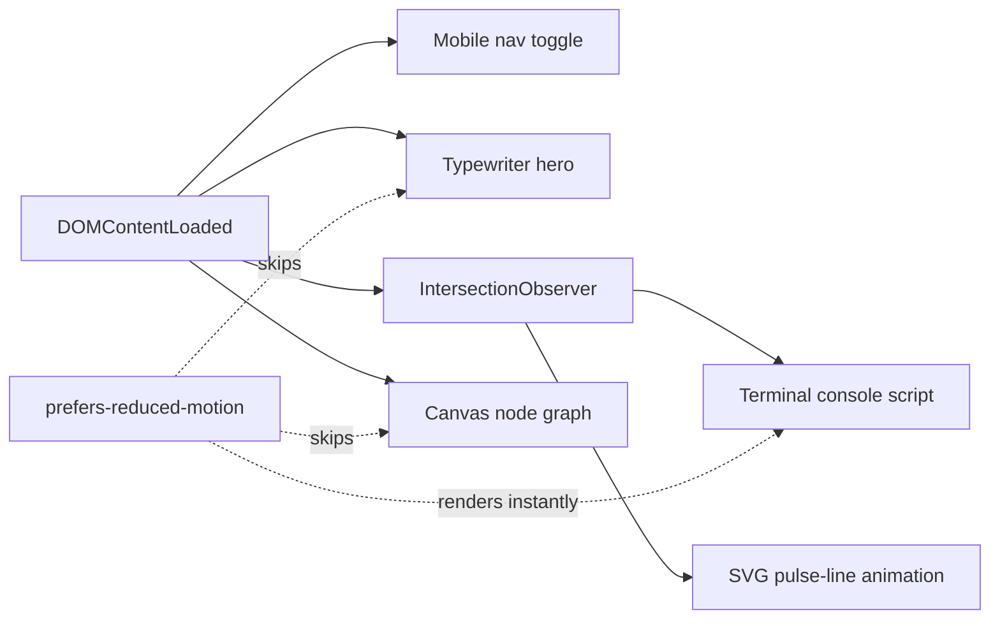

<div align="center">

# `akash@lab:~$` Akash T. — Portfolio

**AI/ML engineer on one side. Offensive web security researcher on the other.**
A dark, terminal-flavoured, zero-dependency portfolio that treats both halves of that story as equals.

<br>

[](https://akashtcaa2005.github.io/Akash-T-Portfolio/)
[](https://linkedin.com/in/akash-t-845439314/)
[](https://github.com/akashtcaa2005)


</div>

---

<!--
  Add a screenshot or GIF here once you have one:
  
-->

## Table of Contents

- [Concept](#-concept)
- [Highlights](#-highlights)
- [Sections](#-sections)
- [Tech Stack](#-tech-stack)
- [Project Structure](#-project-structure)
- [Getting Started](#-getting-started)
- [Customization](#-customization)
- [Design System](#-design-system)
- [Accessibility & Performance](#-accessibility--performance)
- [Deployment](#-deployment)
- [Roadmap](#-roadmap)
- [Contact](#-contact)

---

## 🧠 Concept

Most portfolios pick a lane. This one doesn't.

The site is built around a single idea: **building systems and breaking systems are the same curiosity pointed in two directions.** That pairing drives every design decision.

| Signal colour | Meaning | Where it shows up |
|---|---|---|
| 🔵 **Blue** `#6DA8FF` | AI / ML / data | Primary accents, focus rings, ML & GenAI skill groups |
| 🟠 **Amber** `#F2A93B` | Security | Offensive & web security skill group, security callouts |

Everything sits on a deep green-black canvas (`#0B1210`) with monospace headings, a typing hero, and a live `whoami`-style terminal, so the first screen already feels like a lab bench rather than a template.

---

## ✨ Highlights

- **Typewriter hero.** The headline types itself line by line (`AI/ML engineer.` → `Security researcher on the side.`).
- **Live terminal panel.** A fake shell runs `whoami`, `cat focus.txt`, `ls current/` and `echo $STATUS`, triggered when it scrolls into view via `IntersectionObserver`.
- **Ambient neural-net background.** A `<canvas>` node graph drifts behind the hero. Node count scales with viewport area (capped at 70) and respects device pixel ratio.
- **Hand-built project visuals.** Each project gets its own small custom graphic, with no images or libraries:
  - an animated ECG-style pulse line (SVG) for **BioSense**
  - a mock trade ticker for **PredictX**
  - a docs → embed → vector DB → LLM pipeline diagram for the **LLM Assistant**
- **Timeline experience section** with role, org, dates and impact bullets.
- **Categorised skills** as chips, colour-coded by AI vs. security.
- **Sticky header with mobile menu** that closes automatically after you pick a link.
- **Zero dependencies.** Plain HTML, CSS and JS, with no framework, bundler or `node_modules`.

---

## 🗂 Sections

| # | Section | What's inside |
|---|---|---|
| — | **Hero** | Animated headline, key stats (4 internships · 3 end-to-end builds · 150+ LeetCode), terminal panel, node-graph background |
| 01 | **About** | The "two disciplines, one habit" framing, the BioSense / MSME note, topic tags |
| 02 | **Experience** | Timeline: Handshake AI (Project Lumiere), VEI Technologies, NXT Logic Software Solutions, RV Techlearn |
| 03 | **Projects** | **BioSense**, **PredictX**, **LLM Assistant**, each with a custom diagram |
| 04 | **Skills** | ML & DL · NLP & GenAI · Data & Viz · Offensive & Web Security · Web & Backend · Languages, DBs & Cloud · Tools & Foundations |
| 05 | **Log** | Achievements, certifications (Harvard CS50 AI, NPTEL ML, Hugging Face Agents, HackerRank SQL, IIT Bombay Java) and education |
| 06 | **Contact** | Email, LinkedIn, GitHub |

### Featured projects

<table>
<tr>
<td width="33%" valign="top">

**🫀 BioSense**
Wearable health monitoring and predictive analytics. Reads sensor streams and surfaces patterns, anomalies and trends in real time. Selected under a **Ministry of MSME** initiative.

`Python` `NumPy` `Pandas` `Scikit-learn`

</td>
<td width="33%" valign="top">

**📈 PredictX**
Automated prediction-market trading system. Separate modules for entry, position management, take-profit and risk control, so strategies can be swapped without touching execution.

`Python` `Trading APIs` `Algorithmic Strategy`

</td>
<td width="33%" valign="top">

**🧠 LLM Assistant**
A retrieval-augmented assistant that embeds and indexes your documents, then answers through vector search instead of guessing from memory.

`Python` `LangChain` `RAG` `Vector DB`

</td>
</tr>
</table>

---

## 🛠 Tech Stack

| Layer | Choice | Why |
|---|---|---|
| Markup | **HTML5**, semantic landmarks (`header`, `main`, `section`, `nav`) | Accessible by default |
| Styling | **CSS3** with custom properties, Grid, Flexbox and `@keyframes` | One file, themeable in seconds |
| Behaviour | **Vanilla JavaScript** (ES2015+) in an IIFE | No framework, no globals, no build |
| Graphics | Inline **SVG** and **Canvas 2D** | Crisp at any size, no image weight |
| Fonts | [JetBrains Mono](https://www.jetbrains.com/lp/mono/) (display) and [Inter](https://rsms.me/inter/) (body) via Google Fonts | Terminal character plus readable body text |

---

## 📁 Project Structure

```text
Akash-T-Portfolio/
├── index.html    # All content and page structure
├── index.css     # Theme tokens, layout, responsive rules, animations
├── index.js      # Nav toggle, typewriter, terminal, pulse trigger, node-graph canvas
└── README.md
```

### How the JavaScript is organised (`index.js`)



---

## 🚀 Getting Started

No installs, no tooling.

### Option 1: just open it

```bash
git clone https://github.com/akashtcaa2005/Akash-T-Portfolio.git
cd Akash-T-Portfolio
open index.html        # macOS
# xdg-open index.html  # Linux
# start index.html     # Windows
```

### Option 2: serve it locally (recommended for testing)

```bash
# Python
python3 -m http.server 8000

# or Node
npx serve .
```

Then visit **http://localhost:8000**.

---

## 🎨 Customization

### Change the whole theme

All colours and fonts are CSS variables at the top of `index.css`:

```css
:root {
  --bg: #0B1210;
  --bg-panel: #121B18;
  --text: #E7F3EC;
  --accent-ai:  #6DA8FF;   /* AI / ML signal  */
  --accent-sec: #F2A93B;   /* Security signal */

  --font-display: 'JetBrains Mono', ui-monospace, monospace;
  --font-body:    'Inter', system-ui, sans-serif;
  --max-w: 1180px;
}
```

Swap `--accent-ai` and `--accent-sec` and the entire site re-themes.

> **Heads-up:** the hero's background node graph draws its colour directly in `index.js` (`rgba(94, 234, 212, …)`, a teal). If you change `--accent-ai`, update those two `rgba(...)` values too so the canvas matches.

### Edit the content

Everything is plain HTML in `index.html`, with no templating.

| To change… | Edit… |
|---|---|
| Headline typing lines | `typeInto(...)` calls in `index.js` |
| Terminal commands and output | the `consoleScript` array in `index.js` |
| Hero stats | `.hero-meta` block in `index.html` |
| Add an experience entry | copy a `<li class="tl-item">` inside `<ol class="timeline">` |
| Add a project | copy an `<article class="project project-a">` (use `project-b` to flip the layout) |
| Add a skill | add an `<li>` to the relevant `<ul class="chip-row">` |
| Contact details | `#contact` section |

---

## 🧩 Design System

- **Type:** JetBrains Mono for `h1–h3` (tight 1.15 line-height, −0.01em tracking) and Inter at 16px / 1.6 for body copy, capped at `62ch` for readability.
- **Layout:** a centred `.wrap` container (max 1180px, 32px gutters). Sections collapse to tighter padding below 700px.
- **Breakpoints:** `700px` · `760px` · `800px` · `860px` · `900px` · `980px`, tuned per component rather than one global rule.
- **Shape language:** 3px radius, 1px borders (`#24322D`), panel layering via `--bg-panel` and `--bg-panel-2`.
- **Motion:** typing, scan-line, SVG stroke animation and a drifting node graph, all disabled or collapsed for users who ask for less motion.

---

## ♿ Accessibility & Performance

**Accessibility**
- Honours `prefers-reduced-motion`. Typing effects and the canvas are skipped, and the terminal renders instantly.
- Visible `:focus-visible` outlines on every interactive element.
- Mobile menu button exposes `aria-expanded` and `aria-label`.
- Decorative layers (canvas, scan line, project visuals) are `aria-hidden`; the terminal has a descriptive `aria-label`.
- Semantic landmarks and a logical heading order.
- Smooth scrolling with `scroll-padding-top` so anchors aren't hidden under the sticky header.

**Performance**
- No JavaScript dependencies, no build output, and only one render-blocking stylesheet plus the Google Fonts request (`preconnect` hints included).
- Animations are triggered lazily with `IntersectionObserver` and unobserved after firing.
- Canvas node count is capped (70) and scaled to viewport area, so low-end devices aren't punished.
- All diagrams are inline SVG and CSS, so there are no image requests.

---

## 🌐 Deployment

It's a static site, so any static host works.

<details>
<summary><b>GitHub Pages</b></summary>

1. Push the repo to GitHub.
2. **Settings → Pages → Build and deployment**
3. Source: **Deploy from a branch**, branch: **`main`**, folder: **`/ (root)`**
4. Your site goes live at `https://akashtcaa2005.github.io/Akash-T-Portfolio/`

</details>

<details>
<summary><b>Netlify</b></summary>

1. **Add new site → Import an existing project** and pick this repo.
2. Leave the build command empty and set the publish directory to `/`.
3. Every push to `main` auto-deploys.

</details>

<details>
<summary><b>Vercel</b></summary>

```bash
npm i -g vercel
vercel --prod
```

Framework preset: **Other**. No build command, output directory `.`

</details>

---

## 🔭 Roadmap

- [ ] Add a project screenshot or GIF to this README
- [ ] Add favicon and Open Graph / Twitter card meta tags for nicer link previews
- [ ] Link each project to its GitHub repo and write-up
- [ ] Downloadable résumé (PDF) button in the hero
- [ ] Light-theme toggle driven by the existing CSS variables
- [ ] Split `index.js` into small modules if it keeps growing

---

## 📬 Contact

Building something in AI, or need a second pair of eyes on your app's security? Let's talk.

| | |
|---|---|
| ✉️ **Email** | [akashtcaa.2005@gmail.com](mailto:akashtcaa.2005@gmail.com) |
| 💼 **LinkedIn** | [linkedin.com/in/akash-t-845439314](https://linkedin.com/in/akash-t-845439314/) |
| 🐙 **GitHub** | [@akashtcaa2005](https://github.com/akashtcaa2005) |

> `$ echo $STATUS`
> **open to AI Engineer / GenAI / ML / SDE roles**

---

<div align="center">

Hand-built with plain HTML, CSS and JS. No frameworks were harmed.

⭐ If you like the design, a star on the repo is always appreciated.

</div>
